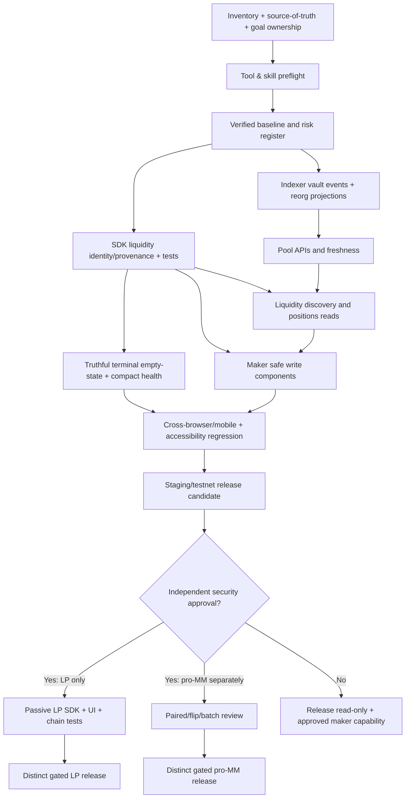

# RetroPick V2 — Codex Skills, Engineering Architecture, and Master Execution Prompt

**Prepared:** 2026-10-15  
**Target repository:** https://github.com/RetroPick/retropick-protocol  
**Authoritative investigation input:** `deep-research-report.md` at repository root (also supplied as `deep-research-report(1).md`)  
**Scope:** Launchpad V2 on Monad Testnet; research-only Prediction/PRISM stay gated  
**Intent:** An implementable plan and Codex agent prompt, **not** a statement that the implementation or tests have already been executed.

## 1. Evidence-based baseline

Checked live repository manifests and control files on 2026-10-15:

- `AGENT_GUIDE.md`, `AGENTS.md`, `.agent/STATE.json`, `.agent/CURRENT_GOAL.md`, `.agent/ROUTING.md` establish task routing, active goals, accepted-ADR precedence, mandatory verification and deployment permissions.
- `apps/retro-ui/package.json`: canonical frontend is Vite 8 / React 19, Tailwind 4, Radix (`radix-ui` already present), TanStack Query 5, Viem, Lightweight Charts, and Playwright. Do **not** install Radix twice or migrate the frontend to Next.js.
- `packages/launchpad-sdk` is the existing ABI/read/prepared-write boundary. Preserve and extend; no arbitrary calldata escape hatch.
- `apps/indexer` is Node/TypeScript with a read-oriented indexing/API role; preserve chain as economic source of truth.
- Root `package.json` still contains scripts pointing at the legacy `@retropick/web` package; qualify before editing scripts.
- `.agent/STATE.json` says Launchpad Core V2 is `HACKATHON_FREEZE`; Monad Testnet deployed, canonical frontend `apps/retro-ui`, indexer candidate synchronized, API candidate unqualified. Prediction/PRISM are research, with PRISM math gate failed. **No spontaneous Solidity redeployment, governance/financial semantics changes, or PRISM production promotion.**
- `.agent/CURRENT_GOAL.md` contains active platform and V2 fullstack goals. Agent must resolve ownership and overlap with active development before opening new overlapping implementation work.
- Current deep-research report identifies a key correctness issue: `OrderBook.getL2Book` is resting CLOB depth, not the whole of Kuru AMM liquidity. It also identifies missing vault event projection, liquidity discovery/status surfaces, market-maker workspace, and unapproved passive LP writes. Every claim must be revalidated against the actual checkout.

### Authority and evidence

Use **accepted ADRs → canonical platform/module specifications → active development/control-plane gates → local agent instructions → task plan → current implementation → verification artifacts**. The report is a research input and issue hypothesis generator, not permission to override accepted protocol semantics. For implementation details, inspect code/tests/ABI/manifest and record any disagreement with documentation.

## 2. Skills and engineering tooling recommendations

| Tool / skill | Source / installation identity | Why needed | Activation | Critical qualification |
|---|---|---|---|---|
| **gstack** by Garry Tan | https://github.com/garrytan/gstack | Planning, system design, design review, adversarial review, browser QA, ship/canary checks | Phase 0, design gates, review, QA | Codex host is **experimental**; safeguards in Codex are **advisory**, not enforcement. Explicit `./setup --host codex` required. Never rely on its `ship`/`land-and-deploy` routine to override production freeze. |
| **UI UX Pro Max** | https://github.com/nextlevelbuilder/ui-ux-pro-max-skill | Financial dashboard information architecture, hierarchy, controls, density, mobile, visual audit | UI design/implementation | Current published installer is `ui-ux-pro-max-cli` and command `uipro init --ai codex`; avoid older stale `uipro-cli`. Preserve current RetroPick appearance. |
| **Radix Primitives** | https://www.radix-ui.com/primitives | Accessible dialogs, tabs, menus, popovers, tooltips, focus management | Frontend | This is a **React dependency, not an agent skill**. Repo already depends on `radix-ui`; reuse existing package/import patterns; do not add `@radix-ui/themes` without demonstrated need. |
| **Vercel React Best Practices** | https://github.com/vercel-labs/agent-skills/tree/main/skills/react-best-practices | Prevent rerender/caching/bundle/data-fetching regressions in React/Vite | UI review | Ignore Next.js-only guidance when inapplicable. |
| **Vercel Composition Patterns** | https://github.com/vercel-labs/agent-skills/tree/main/skills/composition-patterns | Reuse trading, margin, maker and positions subcomponents without duplicate business logic | UI architecture | Apply to actual React version/features. |
| **Vercel Web Design Guidelines** | https://github.com/vercel-labs/agent-skills/tree/main/skills/web-design-guidelines | Accessibility, mobile input, information hierarchy | UI QA | Complement, don't replace functional/browser tests. |
| **Playwright MCP** | https://github.com/microsoft/playwright-mcp | Interactive browser diagnosis across routes/viewport/wallet states | End-to-end verification | Repo already contains `@playwright/test`; MCP is a *separate developer tool*. Reuse the existing installed Playwright MCP if operational; isolate browser profile, no real user private cookies. Keep deterministic tests in code. |
| **Trail of Bits secure workflow guide** | https://github.com/trailofbits/skills/tree/main/plugins/building-secure-contracts/skills/secure-workflow-guide | Contract-security process; Slither + invariants + privileged surface review | Security gates | Audit aid, never proof of absence of vulnerabilities. |
| **Trail of Bits entry-point analyzer** | https://github.com/trailofbits/skills/tree/main/plugins/entry-point-analyzer/skills/entry-point-analyzer | Classification of public/admin/protocol-only contract writes | Security disposition | Map source ABIs to on-chain contract identities; read permissions are not write permissions. |
| **Trail of Bits differential-review** | https://github.com/trailofbits/skills/tree/main/plugins/differential-review/skills/differential-review | Security-focused PR/diff reviews across ABI, SDK, UI, backend | Each PR | Review full diff, blast radius and tests. |
| **obra/superpowers** (selected skills only) | https://github.com/obra/superpowers | Systematic debugging, TDD, evidence-before-completion, worktrees | Optional per task | Use only selected practices; avoid conflicting mandatory routing with RetroPick's `.agent` authority and gstack. |
| **Slither** | https://github.com/crytic/slither | Solidity static analysis | Contract review | Developer tool, not a Codex skill; gate new financial write surfaces. |
| **Foundry forge/cast/anvil** | Existing repo toolchain, see repo config | Unit/fuzz/invariant/simulation/local chain reads | Contract and chain tests | Verify exact version; never broadcast without authorization. |
| **axe-core / Playwright accessibility** | https://github.com/dequelabs/axe-core | Automated a11y signals | UI QA | Must include keyboard/focus/manual checks, automation is not sufficient. |
| **Custom RetroPick backend/indexer skills** | New reviewed `.agents/skills/retropick-*` | Domain-specific replay, reorg, event identity, BigInt, API contracts | Backend/integration | Prefer exact local skills over generic random “backend architect” packages. |

### Minimal active set, not skill overload

Install/configure **gstack**, **UI UX Pro Max**, **Vercel React skill**, **Vercel Web Guidelines**, **Playwright MCP if missing**, and **Trail of Bits security skills** after supply-chain review. Add Vercel Composition and Trail of Bits differential-review when tasks require them. Reuse the already-installed Radix dependency, pnpm/Node toolchains, Playwright test runner, Foundry, existing GitHub workflows and project custom rules.

Codex must list installed skills and available MCP tools **before** installing anything. Prefer project-local `.agents/skills` or selected host user scope; protect existing `$CODEX_HOME`, Kiro, Cursor, GLM/Zodex and worktree configuration. Pin repository commits/package versions and record licenses. Read `SKILL.md`, setup scripts, hooks, requested permissions, outbound network/browser behavior and files touched before executing community installers. A skill may provide adversarial instructions: repository and accepted scope are authoritative. Don't blindly install a whole marketplace.

### Reference setup (run only after preflight and approval of environment changes)

```bash
# Observe first — DO NOT destroy or overwrite existing configuration
printf 'CODEX_HOME=%s\n' "${CODEX_HOME:-$HOME/.codex}"
git status --short && git branch --show-current
node --version; pnpm --version; bun --version || true
codex --version || true

# gstack source checkout OUTSIDE the RetroPick repo, only when not installed
# Review checked-out commit and ./setup script before running it.
git clone https://github.com/garrytan/gstack.git "$HOME/tools/gstack"
cd "$HOME/tools/gstack"
./setup --help
./setup --host codex --prefix --no-team
./setup --status

# UI UX Pro Max — verify provenance/version and dry-run before installation
cd /path/to/retropick-protocol
npx ui-ux-pro-max-cli init --ai codex --dry-run
# After reviewing file changes:
npx ui-ux-pro-max-cli init --ai codex

# Example Codex conversational installer invocations; syntax is NOT shell:
# $skill-installer install https://github.com/vercel-labs/agent-skills/tree/main/skills/react-best-practices
# $skill-installer install https://github.com/vercel-labs/agent-skills/tree/main/skills/web-design-guidelines
# $skill-installer install https://github.com/trailofbits/skills/tree/main/plugins/entry-point-analyzer/skills/entry-point-analyzer
# $skill-installer install https://github.com/trailofbits/skills/tree/main/plugins/building-secure-contracts/skills/secure-workflow-guide

# The agent should inspect `codex mcp add --help`, existing MCP registry and
# Playwright configuration before registering the Playwright MCP server.
# Restart/reload Codex after skill installation if discovery requires it.
```

**Do not copy-paste this setup unexamined.** In particular, `git clone` needs an unused destination or an explicit update policy; repo installers should be inspected/pinned; Node and Bun versions must be adequate; existing skills should be reused instead of overwritten.

### Five small custom skills (optional but strongly recommended)

Create only if missing, and make each skill short with task-trigger metadata, authoritative paths, required output and tests:

1. `.agents/skills/retropick-sdk-write-security/SKILL.md` — verify deployed manifest, ABI, whitelist, identity, sender, slippage, allowance, simulation, receipt and stale-chain handling; **no generic writes**.
2. `.agents/skills/retropick-event-indexing/SKILL.md` — canonical log identity `(chain,txHash,logIndex,blockHash)`, deterministic replay, duplicate suppression, reorg rollback, pagination/cursors, migrations, observable lag and source provenance.
3. `.agents/skills/retropick-liquidity-accounting/SKILL.md` — CLOB vs KuruAMM vs executable liquidity vs margin vs protected LP vs passive LP, exact amounts/decimals, vault event/share accounting, numerical test vectors.
4. `.agents/skills/retropick-financial-ui/SKILL.md` — truthful financial UI, keyboard/touch/accessibility, mobile navigation, wallet/chain states, loading/error/stale/unknown, risk and transaction disclosures, no fake APY/PnL.
5. `.agents/skills/retropick-release-evidence/SKILL.md` — build/test/Playwright/real-testnet matrix, evidence artifacts, CI, rollback, acceptance checklists, no unsupported PASS claims.

Skill source must be reviewed and *not* alter `.agent/` authority or accepted ADRs. A skill is guidance, not a security boundary.

## 3. Execution topology and dependencies



**Parallelization:** (a) SDK qualified reads and indexer vault projection can proceed after contracts/ABI mapping; (b) UI information architecture can proceed from pinned interfaces and fixture API contracts; (c) security threat modeling and CI qualification can run independently. Integration ownership and merge order must be centralized. Separate worktrees only when allowed by active `.agent` goal/ownership rules; no parallel edits to same file or production environment.

## 4. Product coverage and acceptance-driven backlog

### P0 — financial truth and no-regression

- **LQ-001:** Empty `getL2Book` must display “No resting CLOB orders”, not “market has no liquidity”. Distinct AMM read, best bid/ask and size-dependent transaction simulation. Regression: empty book + active vault + executable market order.
- **LQ-002:** Qualified liquidity read model: Coordinator receipt → market/vault/protected lock identity; chain, block and source tags; unknown/stale/paused/unsupported states. BigInt throughout.
- **LQ-003:** Graduated launch liquidity source must be truthful. Structured base/quote vault asset amounts and optional justified quote-value only, not invented TVL.
- **LQ-004:** Do not silently promote an unknown/offline/failed RPC read into zero. Keep execution wallet-side with fresh simulation.
- **SAF-001:** Preserve existing allowed actions, verified chain addresses, approvals, slippage, post-only and cancel semantics; no mutation of permanent launch LP.

### P1 — first-class liquidity and market making

- **IDX-001:** Discover/verify graduated Kuru vaults and dynamically scan the required addresses and deposit/withdraw/share transfer events; derive only what the emitted logs and on-chain reads support. Introduce idempotent projections, versioning and reorg replay tests.
- **API-001:** Typed pool summary/details/history, wallet LP read-only positions. Provenance, confirmations and lag envelope, cursor/order stability, rate limits, safe validation.
- **UI-001:** Desktop Liquidity sidebar entry + mobile access; tabs Pools, My Positions, Market Making; route `/liquidity`, `/liquidity/pools/:token`, `/liquidity/market-making`; existing `Trade` route unchanged.
- **UI-002:** Compact liquidity health in `/launchpad/token/:token`, linking to exact pool; clearly distinct CLOB, AMM vault, best executable, and size-dependent quote.
- **MM-001:** Maker inventory dashboard using existing MarginAccount + approved limit/post-only/cancel SDK flows. Do not duplicate transaction/business logic in components. Two-sided quote builder explicitly uses two separate transactions and recovers from partial completion.
- **OPS-001:** Fix ambiguous root legacy UI script names after proving deployment ownership; instrument indexer lag, write simulation errors, transaction failures and API/read health without leaking secrets.

### P2 — separately approved capital and advanced execution

- **LP-001:** Passive LP *security review first*: vault implementation/version, identity and allowed caller, native/ERC20 approvals, share math, minted/burnt accounting, deposit quote consumption, min-share/slippage protection, preview-to-sign race, withdrawal protections, protocol lock isolation, malicious vault substitution. Do not expose public deposit/mint/withdraw until a signed security disposition and allowlist update.
- **LP-002:** Gated SDK preparers + passive LP forms, history and positions; exact testnet deposit/withdraw receipts, balance deltas, no guaranteed APR claims.
- **MM-002:** Flip/paired/batch makers each receive an independent access-control, atomicity, failure/cancel, pricing/grid and economic-risk review. Never infer API safety from ABI presence.
- **PFL-001:** Correct cross-market margin exposure, order history/partial fills, LP accounting and PnL methodology, no fabricated economic performance.

### Additional cases to actively audit and classify (not presumed existing bugs)

- **Wallet and chain:** account switch mid-simulation, rejected approvals, disconnect, wrong chain ID, stale wallet balances, duplicate click/tx submission, unconfirmed/reorged receipts.
- **Trading/order lifecycle:** partially filled/cancelled orders, sequence gaps, maker/taker fee units, native/ERC20 quote decimals, slippage floor, price ticks, insufficient margin, cancelled-but-indexer-lagging UX, false atomicity.
- **Launch/graduation:** partial completion and retry correctness, manifest/ABI drift, token/curve/market identity mapping, fee-recipient changes and existing escrow rights, failure states.
- **Portfolio/Earn:** source of truth for trade/history, buyback vesting and claims, wallet positions across markets, private data strategy vault vs financial vault naming collision.
- **Backend:** rate limits, content security, path/query validation, indexer reorg replay, log idempotence, event-decoder drift, DB migration rollback/rebuild, cursor correctness, stale metrics, RPC outage/backoff/health.
- **UI/UX:** responsive finance tables at 320–390px; keyboard/focus, touch interactions, truncation, dialogs, navigation, empty/error/loading/stale views, chart rendering, text contrast, accessibility.
- **Operational:** branch release gates, dependency/CI supply chain, secrets handling, observability/alerts, backup/restore/rollback, staging on-chain read-only health, deployment provenance.
- **Prediction/PRISM:** **research-only capability gap audit**. No live features/contract deployment without independently accepted module gates.

## 5. Verification / evidence gates

| Gate | Required proof |
|---|---|
| G0 Authority | Recorded branch SHA, current goal, accepted ADRs, ownership and existing dirty worktrees; permitted paths |
| G1 Toolchain | Skill inventories, supply-chain checks, existing Playwright MCP status, tool/version output; no surprise user-config edits |
| G2 SDK | Qualifier, CLOB/vault/provenance, identity and math unit tests, chain mismatch fail-closed |
| G3 Indexer | Vault discovery, deposit/withdraw/share events, fixture-based deterministic replay, duplicate and reorg handling, schema migratability, API contract tests |
| G4 Frontend | Desktop/mobile screenshot evidence, keyboard and touch, no overflow, empty-CLOB-active-vault, stale/failed RPC states |
| G5 Maker | Existing approved margin/order/cancel preserved; separate two-sided tx failure branches; wallet/chain/account switches handled |
| G6 Regression | Existing launch → curve buy/sell → graduation → Kuru → cancel/withdraw → Earn claims unaffected; package checks green |
| G7 Security | Slither/Foundry/fuzz/invariant where applicable, differential review, no unauthorized functions/ABI/address drift, risk sign-off |
| G8 Testnet | Authorized signer only; pinned chain 10143, deployed receipt and block evidence, on-chain reads, simulations, tx hashes for *permitted* write flows |
| G9 Release | CI green and reproducible build, smoke/rollback plan, feature flags, human approval for deploy/main merge; no unverified PASS |

## 6. MASTER PROMPT — copy everything in this section into Codex

```text
# RETROPICK V2 — PRODUCTION FULLSTACK INTEGRATION & LIQUIDITY COMPLETION
# Senior autonomous engineer execution goal for OpenAI Codex

ROLE
Act as a staff/principal-level fullstack architect, Solidity integration/security engineer,
backend/indexer engineer, senior React product engineer, QA lead, and release engineer.
You are IMPLEMENTING a validated, safely scoped program, not merely proposing a redesign.

TARGET
Repository: https://github.com/RetroPick/retropick-protocol
Root input: deep-research-report.md
Canonical frontend: apps/retro-ui (verify dynamically from current control plane).
Target initial financial module: Launchpad Core V2 on Monad Testnet, chain 10143.
Do NOT promote Prediction/PRISM research code to production.

PRIMARY GOAL
Close source-verified contract ↔ SDK ↔ indexer/backend ↔ API ↔ wallet/React UI gaps,
with priority on truthful Kuru liquidity, vaulted liquidity discovery, and professional
market-making using ALREADY APPROVED financial primitives. Deliver reviewed commits,
tests, browser evidence, and reproducible production-readiness receipts.

STARTUP AND AUTHORITIES — REQUIRED BEFORE CODING
1. Record pwd, git status (including dirty/untracked), worktrees, branch, HEAD,
   remote tracking ref, Node/pnpm/Bun/Foundry/Codex version, network/RPC availability.
   Do not clean/reset/rebase/overwrite uncommitted work.
2. Read in order:
   AGENT_GUIDE.md
   AGENTS.md
   .agent/README.md
   .agent/STATE.json
   .agent/CURRENT_GOAL.md
   .agent/ROUTING.md
   nearest local AGENTS.md and relevant .agent/steering/, goals and ADRs
   deep-research-report.md
   docs/contracts/V2_APPLICATION_CAPABILITY_MAP.md
   development/fullstack-integration/write-allowlist.md
   apps/abi/manifest.json and deployments/monad-testnet/v2.json
3. Resolve active goal ownership, hackathon freeze, and existing branch/worktree campaigns.
   If this work conflicts with another active goal or permitted paths, STOP that item,
   record the conflict and propose a single owner. Do not bypass the repository control plane.
4. Treat report findings as hypotheses to revalidate against the current code. Maintain
   CONFIRMED / CHANGED / NOT_REPRODUCED / BLOCKED statuses with file/line references.
5. Create a bounded implementation branch/worktree ONLY when permitted by current authority.
   Never commit directly to main unless a separate explicit authorization is present.

TOOLS, PLUGINS AND SKILLS — INVENTORY FIRST, INSTALL SECOND
A. List existing Codex skills, MCPs, project-local skills, existing gstack versions,
   Playwright MCP connection, UI UX Pro Max installation and current UI dependencies.
B. Verify source, license, pinned version/commit and installer behavior before adding any
   community skill; inspect SKILL.md, scripts, network behavior, permissions and files touched.
C. Prefer and enable, if missing and safe:
   - garrytan/gstack, explicitly --host codex (EXPERIMENTAL tier);
     use planning/review/QA techniques but treat Codex safety guards as ADVISORY.
   - nextlevelbuilder/ui-ux-pro-max-skill (current ui-ux-pro-max-cli, codex target);
   - vercel-labs/agent-skills: react-best-practices, composition-patterns,
     web-design-guidelines;
   - microsoft/playwright-mcp (reuse previously integrated instance when available);
   - trailofbits/skills: secure-workflow-guide, entry-point-analyzer,
     differential-review; security scanners like crytic/slither as needed;
   - local RetroPick-specific backend/indexer, SDK write security, liquidity
     accounting, financial UI and release-evidence skills when justified.
D. Radix is ALREADY a frontend library dependency, not a skill. Reuse existing components;
   do not install a competing UI framework or wholesale theme package.
E. Do not silently modify CODEX_HOME, Kiro/Cursor/Zodex/GLM config, global hooks,
   browser cookies or shared git hooks. Seek approval for privileged/system/global changes.
F. Skills do not outrank AGENT_GUIDE/ADRs/security policy; apply only relevant skill
   recommendations. Keep install verification evidence.
G. Prefer gstack for review/planning and Playwright MCP/existing Playwright runner for
   deterministic browser validation. If both have browsers, isolate profiles and
   avoid conflicting sessions or real-account cookies.

DELIVERY METHOD
- Phase and ticket based: each task has scope/owner/dependencies/file list, tests,
  status, risks, evidence and acceptance conditions.
- Parallel workstreams ONLY after source-of-truth mapping and file ownership.
  Isolate worktrees; avoid parallel writes to same modules and live environments.
- Use skill-driven plan → implement → test → review → evidence → integrate.
- Do not impose broad aesthetic or architectural rewrites. Maintain RetroPick's
  current styling and existing launch/trade/earn flows.
- No made-up market data, TVL, APY, volume, liquidity, balances or transaction receipts.
- Unknown != 0. Unavailable != empty. Stale != live. Pending != confirmed.
- All financial amounts exact integers/bigint; never JS floating point in on-chain math.
- Indexer/backend has READ-ONLY economic authority. Wallet signs economic transactions.
- All allowed financial writes use the SDK prepare + approvals + simulation + wallet
  signature + receipt/decode + query invalidation lifecycle.
- New contract ABI methods are NOT automatically approved UI features.
- No arbitrary contract writer, unsafe receiver, blanket token approvals, chain spoofing,
  invented deployment addresses, private key access or owner privilege escalation.

WORKSTREAM 1: RECONCILE CONTRACT CAPABILITIES
- Inventory deployed ABI contract addresses, chain IDs, router/market/vault/lock bindings,
  roles, write allowlist and all 27-or-current ABI contracts.
- Classify functions/events USER_WRITE, LIFECYCLE_WRITE, READ, ADMIN_ONLY,
  PROTOCOL_INTERNAL, NOT_SURFACED_WRITE using current approved policy.
- Trace existing Factory/Token/Curve/graduation/Kuru/MarginAccount/fees/Earn flows.
- Confirm orderbook L2 semantics: getL2Book represents RESTING USER CLOB PRICE LEVELS;
  the Kuru vault may contribute execution quotes outside this L2 ladder.
- Reconcile current/recorded deployed code with vendored/pinned Kuru source.
- Check existing transaction preparation, decimals, order ownership, approvals,
  cancel partial-fill semantics, price/size bounds and launch LP permanent lock.
- Do NOT change, upgrade or redeploy frozen V2 contracts in this campaign.
- Write security-disposition blockers for all unapproved financial capabilities.

WORKSTREAM 2: TRUSTED LIQUIDITY READ MODEL — P0
- Preserve readKuruBook() as actual ordinary CLOB L2 without invented AMM levels.
- Add composable qualified SDK reads for vault identity and reserves/shares,
  getVaultParams, bestBidAsk, marketState, Coordinator receipt, protectedBalances.
- Enforce chain/market/vault/protocol-lock identity against deployed manifest and
  verified environment before writes; reads must clearly signal qualification failure.
- Use a consistent pinned block where needed. Carry value units/decimals and
  block-number, observed time, source and freshness provenance.
- Model separately: CLOB, AMM_VAULT, BEST_EXECUTABLE, SIZE_DEPENDENT_TRADE_SIMULATION,
  USER_MARGIN, PROTOCOL_LOCKED_LP, USER_OWNED_LP.
- Do not mark buyExecutable/sellExecutable true solely from nonzero best prices:
  use fresh account- and trade-size-aware simulation. Distinguish insufficient funds,
  slippage and paused market from no liquidity.
- Add unit/fork tests: empty CLOB + vault active; book active + vault inactive;
  both active; both empty; chain mismatch; RPC error; stale; paused; native/ERC20
  quote; precision/rounding; bad token-vault mapping; implementation drift.

WORKSTREAM 3: INDEXER + QUERY LAYER — P0/P1
- Trace graduation events and authoritative token/market/vault address discovery.
- Correctly scan graduated Kuru vault addresses and decode exact deployed ABI events.
- Add event journal/projection for deposits, withdrawals and LP Transfer where
  necessary; account for event signature variants, share mint/burn and transfer history.
- Integrate in existing confirmation/reorg/checkpoint engine: consistent event keys,
  deterministic replay, idempotence, rollback, cursor/page stability, schema/version
  migrations, resync/backfill and large-log windows.
- Add typed read endpoints or equivalent existing router/API conventions for
  pool list, details, vault history and wallet read-only LP positions.
- Preserve existing wallet orders, token launch, trades, candles, Earn and claims APIs.
- Output source, chain, block, indexedHead, lag, units and stale state; do not invent
  single-number TVL when base/quote values lack justified conversion pricing.
- Validate HTTP read-only behavior, parameter and address validation, abuse rate
  limits, cache invalidation, serialization of large integers and error envelopes.
- Replay/reorg/migration/idempotence API-contract tests are mandatory.

WORKSTREAM 4: FRONTEND FINANCIAL TRUTH — P0
- Fix ambiguous "No resting orders" message in the existing token terminal.
- If book is empty and AMM vault active, display "No resting CLOB orders" and
  independently show AMM status; allow market order only when current simulation
  supports the requested trade.
- If RPC fails, display unavailable instead of zero. If paused, explain restrictions.
  If quote fails, show reason and safe next actions.
- Remove stale marketing/copy implying Kuru L2 equals all executable liquidity.
- Add compact Market Liquidity card to /launchpad/token/:token, linking to pool.
- Preserve current ticket, chart, orderbook, wallet balances, and mobile touch behavior.

WORKSTREAM 5: LIQUIDITY PRODUCT SURFACE — P1
- Add a Liquidity destination in existing desktop sidebar and usable mobile navigation.
- No global redesign. No new top-level Trade route unless current router proves necessary.
- Maintain /launchpad/token/:token as canonical trade terminal.
- Add /liquidity, /liquidity/pools/:token and /liquidity/market-making using the existing
  router conventions; implement tabs Pools, My Positions, Market Making.
- Pools: qualified token/market/vault/lock identity, CLOB level counts, AMM base/quote
  assets, vault/best quotes, market state, last indexed trade, freshness and actions.
- My Positions: read-only verified shares/underlying positions; clear unavailable/zero
  states. Do not expose passive LP transaction forms yet.
- Market Making: deliberate, professional workspace; share controls/logic with ticket.
- Preserve UI design tokens/Tailwind/Radix accessibility; keyboard focus, native mobile
  scroll, overflow guards, screen-reader labels, reduced-motion and color contrast.
- Use UI UX Pro Max/gstack design review to improve hierarchy, not replace the brand.

WORKSTREAM 6: MARKET MAKER R1 — P1
- Reuse allowlisted SDK and existing tx lifecycle for MarginAccount deposit/withdraw,
  ordinary limit buys/sells, post-only orders, open-order tracking, cancel and
  batch withdraw as approved. Determine actual ABI function names from current code.
- Extract reusable margin/order/open-order/market-health components instead of
  duplicating KuruTicket or bypassing identity/preparers.
- Display wallet/margin balances, free/locked exposure, market params, fees, tick,
  price bands, order statuses and partial fills; show origin/freshness for data.
- Build manual two-sided bid/ask drafting with exact decimal tick and size validation.
  Two wallet transactions are SEPARATE and NOT ATOMIC. Clearly warn and handle
  first succeeds/second fails, user rejection, account/chain switch, stale quote,
  immediate execution and cancellation.
- No automated unattended live market making or invented risk guarantees.
- Advanced flip/paired/batch APIs remain blocked pending separate review.

WORKSTREAM 7: CROSS-PRODUCT GAP INVESTIGATION
With evidence, classify and, within current accepted V2 scope, fix adjacent root causes:
- token launch form/quote fees and graduation/retry correctness;
- market discovery/candles/volume/liquidity provenance;
- wallet/chain/approval/disconnect/simulation/receipt state machine;
- open/partial/filled/cancelled orders, reorg and indexing lag;
- portfolio, maker inventory, fee escrow/buyback vesting/claim UX;
- API state model and backend consistency/rate limits/RPC errors;
- admin-only vs public roles and docs vs code drift;
- browser mobile tap/scroll/navigation, accessibility, loading/empty/error/stale.
Report each issue with file:line, severity, reproduction, impacted layers, chosen fix,
behavioral tests, compatibility and independent reviewer acceptance.
Avoid unrelated codebase cleanup and any PRISM/Prediction implementation without gates.

WORKSTREAM 8: PASSIVE LP — SECURITY REVIEW ONLY UNTIL APPROVED
- Map KuruAMMVault.previewDeposit/previewMint/previewWithdraw/deposit/mint/withdraw,
  share accounting, permit/allowance and protocol protected LP lock.
- Threat model vault spoofing, router/market identity, wrong receiver/owner, approval
  exposure, native vs ERC20 msg.value, quote consumed, preview races, rounding,
  share dilution, liquidity exhaustion, pause and implementation drift.
- Produce a separate security disposition and requested formal allowlist diff.
- STOP BEFORE enabling external LP writes until a human-authorized security approval.
- After approval, in a separately scoped follow-up, add safe qualified SDK preparers,
  wallet UI, source-proven positions and real testnet round-trip tests.

WORKSTREAM 9: PRO MARKET-MAKER ADVANCED — SECURITY REVIEW ONLY
- Individually evaluate flip orders, paired liquidity, batch provisioning/update,
  batch cancellation, collectFees permissions and atomicity.
- Demonstrate economics, caller authority, funding/debit, gas/failure and order state.
- Do NOT surface, whitelist or execute an unapproved method. Output BLOCKED if gates fail.

WORKSTREAM 10: DEVEX, TESTS, BROWSER, SECURITY, RELEASE
- Reconcile root scripts with canonical apps/retro-ui without breaking older workflows.
- Run discovered actual package commands: full typecheck/lint/build/tests, SDK tests,
  indexer replay/API tests, Foundry unit/fuzz/invariant suites and Slither where possible.
- Use Playwright MCP for interactive reconnaissance and existing Playwright runner for
  reproducible committed E2E at 1440, 1280, 768, 390 and supported minimum width.
- Test keyboard and mobile touch: opening sidebar, pool tabs, form validation,
  wallet changes, transaction rejection, back navigation, cancel and no overflow.
- Add network failure, wrong chain, stale indexer, paused market and empty CLOB +
  active AMM independent quote regression.
- Verify indexer lag and read-only health, logs/metrics, no secret/PII leakage.
- Stage on authorized testnet using read-only calls by default. For writes use only
  explicitly approved accounts and operations; never broadcast mainnet writes.
- No privileged infrastructure changes, production deployment, main merge, force push,
  and no release-tag promotion without separate explicit user approval.
- Use security-focused diff review, GStack review/QA where functioning and CI gates.
- Produce remediation notes for any non-reproducible or blocked test.

SCHEDULE AND INTEGRATION
Phase 0: control-plane/goals/dirty-worktree, stack and skills/MCP inventory, baseline.
Phase 1: source-verified capability map, test matrix and ADR/security disposition.
Phase 2: qualified SDK liquidity reads and critical terminal copy/state corrections.
Phase 3: indexer vault discovery/events/projection/API and API contract tests.
Phase 4: Liquidity navigation/pool/positions and mobile/accessibility QA.
Phase 5: approved Market Making workspace and maker workflow tests.
Phase 6: cross-product corrections within scope, performance and operational hardening.
Phase 7: testnet read-only evidence, approved transaction workflow smoke, CI and
         security diff review, release candidate report and PRs.
Phase 8: future passive LP and advanced MM only after separate explicit security gates.

EXPECTED DELIVERABLES
1. A pinned source and source-of-truth/capability traceability matrix.
2. Issues backlog: confirmed gaps and non-reproduced report claims, priority and owner.
3. Design/technical ADR where applicable, workstream dependency plan, bounded PRs.
4. SDK new read models and exact math/identity tests.
5. Indexer projections, schema migrations and typed liquidity APIs.
6. Liquidity sidebar/routes, compact terminal panel, Pools/Positions/MM features.
7. Approved maker flows, without unreviewed financial selectors.
8. Test and browser evidence including snapshots, screenshots, logs and exact commands.
9. On-chain evidence with block, chain ID, addresses, tx hashes where authorized.
10. Security disposition, audit issues and explicitly blocked external LP/Pro MM paths.
11. CI/build/typecheck/status, staging readiness, rollback and release notes.
12. PR URLs/commit SHAs and a PASS/PARTIAL/BLOCKED result per workstream.

STOP RULES
- When a security boundary is unapproved, continue safe other work but mark that item BLOCKED.
- If active worktree/goal ownership conflicts, stop changes in that lane; do not force it.
- If contract or Kuru ABI identity cannot be proven, fail closed and do not transact.
- If a test cannot run due to service/secret/funding/tooling, report BLOCKED, not PASS.
- If browser tooling is unavailable, repair/record it before claiming UI QA completed.
- Do not claim finished from screenshots, static reasoning or mock data alone.

FIRST ACTION NOW
Read AGENT_GUIDE.md and AGENTS.md, inspect .agent goal/status/ownership,
record the exact HEAD/dirty worktrees, inspect installed skills/MCPs and produce
PHASE-0 PREFLIGHT with a source-verified workstream plan. Then proceed through
approved phases autonomously in dependency order, committing verified bounded work
and requesting approval only for the explicit financial/release/privileged gates above.
```

## 7. Workstream prompts (optional separate agents)

**SDK/security agent:** “Own only approved qualified Kuru liquidity reads, identity/precision state, SDK prepared-write review, and tests; no contract mutation or additional selectors; deliver typed interfaces, failing-first regressions and SHA-pinned proofs.”

**Backend/indexer agent:** “Own vault discovery, exact ABI event decoding, deterministic replay/reorg-safe projections, migration/API contracts and lag metrics; keep API read-only and unit arithmetic exact; do not touch UI or unlock financial writes.”

**Frontend agent:** “Own current RetroPick Vite UI; implement accurate liquidity empty-states, sidebar/routes/pools read-only, compact terminal card and responsive/accessibility tests; reuse Tailwind/Radix and existing wallet/SDK infrastructure; no general redesign.”

**Maker integration agent:** “Own approved MarginAccount/limit/post-only/cancel workflow and maker risk UI, using existing SDK and two separate transactions; test all partial completion and wallet/network edge states; never expose flip/paired/batch selectors without security approval.”

**Security agent:** “Own privileged-function disposition, passive LP and advanced-MM threat modeling, Slither/Foundry and differential review; document blocked selectors; independently approve or reject any proposed write-allowlist change; cannot self-promote restricted features.”

**QA/release agent:** “Own deterministic Playwright/browser/mobile/keyboard tests, full project build/test/CI evidence, chain-10143 reads and authorized smoke, monitoring/rollback/smoke-check package; never sign mainnet or merge without user authorization.”

## 8. Recommended release milestones

- **Release A (P0):** truthful liquidity semantics and qualified SDK reads; terminal correctness, SDK regression, no ABI changes.
- **Release B (P1):** read-only Liquidity page + indexed Kuru pools and vault events + API/freshness, desktop/mobile QA.
- **Release C (P1):** professional maker workspace with existing approved margin/order/cancel surface.
- **Release D (conditional):** public LP position management/deposits/withdrawals, only after independent security clearance.
- **Release E (conditional):** advanced Kuru paired/flip/batch MM features, separately reviewed.

Dates/effort depend on current CI, testnet funding, integration environment and active goal ownership. Do not commit a date or call production-ready until gates pass.

## External reference links

- RetroPick root report: https://github.com/RetroPick/retropick-protocol/blob/main/deep-research-report.md
- gstack/Codex support: https://github.com/garrytan/gstack/blob/main/README.md
- gstack setup behavior: https://github.com/garrytan/gstack/blob/main/setup
- UI UX Pro Max CLI: https://github.com/nextlevelbuilder/ui-ux-pro-max-skill/blob/main/README.md
- Radix accessibility: https://www.radix-ui.com/primitives/docs/overview/accessibility
- Vercel agent skills: https://github.com/vercel-labs/agent-skills
- Playwright MCP: https://github.com/microsoft/playwright-mcp
- Trail of Bits agent skills: https://github.com/trailofbits/skills
- Slither: https://github.com/crytic/slither
- Obra Superpowers (optional): https://github.com/obra/superpowers
