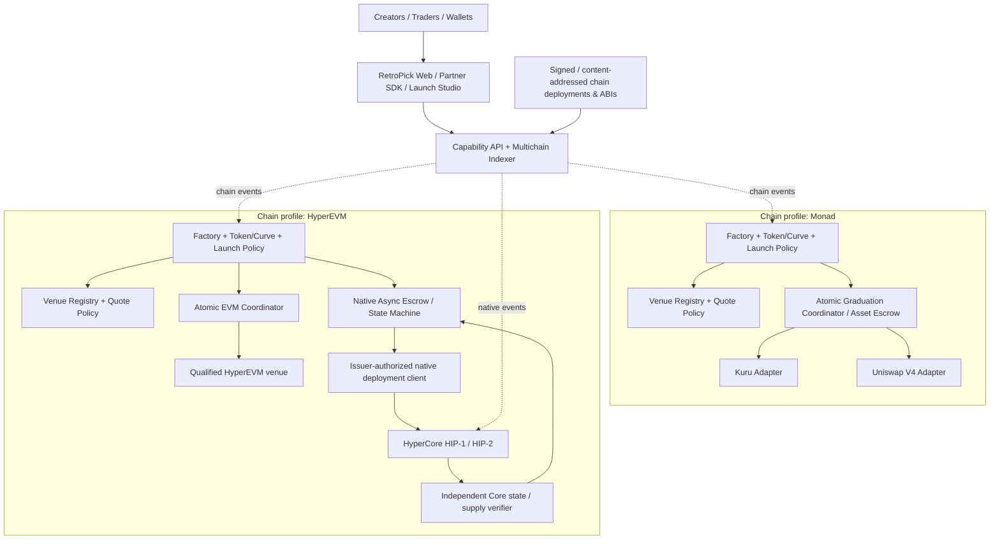
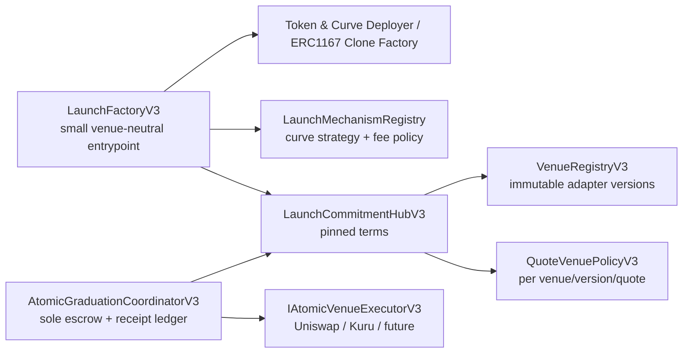
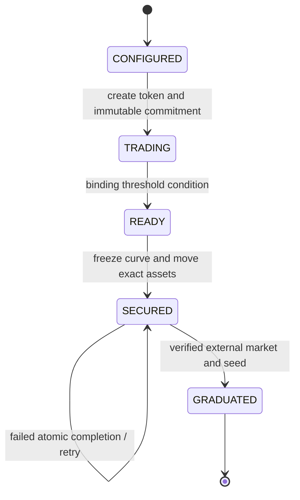
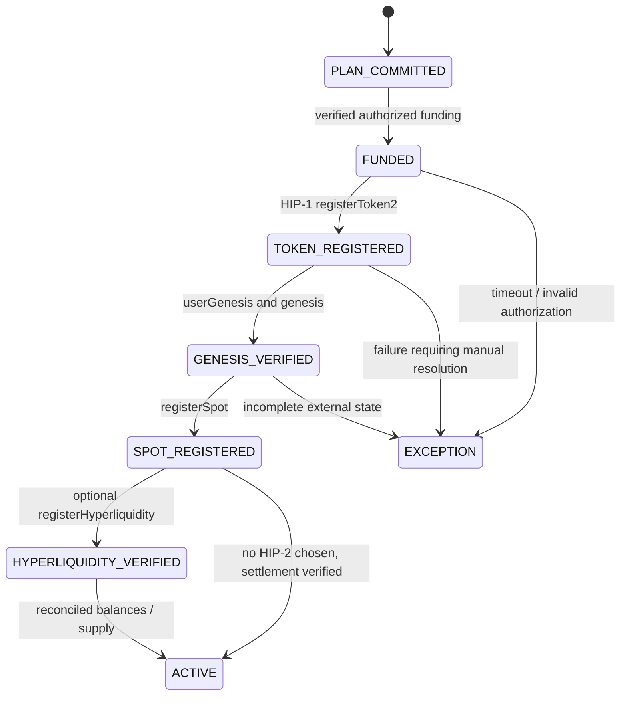

# RetroPick V3 — Multichain / Multivenue Engineering Landscape

**Status:** PROPOSED SYSTEM ARCHITECTURE + UNQUALIFIED FRAMEWORK PROOF  
**Date:** 2026-11-01  
**Reference baseline:** main merge `6be1e84ccbdd800a0744331b9106021e8a71272b`  
**Scope:** RetroPick **asset launchpad** only: issuance, distribution, fees, graduation and liquidity monitoring. **Not PRISM or prediction markets.**

> Separate **chain**, **launch mechanism**, **venue**, **settlement class** and **community-economy modules**. Supporting N venues must not require N venue branches or N implementation imports in a central Factory.

## 1. What exists, what is proposed, and what is proven

### Source-derived V2 reality

- `contracts/src/v2/RetroPickLaunchFactoryV2.sol` is 1,147 source lines at the audited baseline. The Factory constructor still requires Uniswap V4 PoolManager, PositionManager, Permit2, meme hook, locker, fee escrow, vault, quote registry and coordinator. `_requireLaunchDependenciesWired()` enforces V4 wiring even if Kuru is selected. The legacy launch overloads default to V4.
- `contracts/src/v2/GraduationCoordinatorV2.sol` already owns the sole graduation ledger, snapshots executor address/code hash and supports durable `secure()` plus atomic retryable `complete()`. This pattern should be preserved.
- `KuruGraduationExecutorV2.sol` and `UniswapV4GraduationExecutorV2.sol` are **already separate contracts**. Extracting Kuru implementation is NOT the pending work.
- `IGraduationExecutorV2.sol` has a fixed `GraduationVenue { UNISWAP_V4, KURU }` and universal V4/Kuru-oriented packet and LP receipt.
- `RetroPickQuoteAssetRegistryV2.sol` pins `TARGET_CHAIN_ID = 10143`, Circle test USDC and a `venueMask <= 3`. Adding venues or chains therefore needs more than an adapter deployment.
- The historical deployed V2 Factory runtime was reported as **23,423 bytes** with Foundry/solc 0.8.26, `via_ir`, 200 optimizer runs (see `contracts/README.md`). This is **historical evidence**, not a fresh measurement.
- `contracts/src/v2-research-experiment/` contains unqualified community-economy modules. They require their own accounting and rights gates. Do not silently promote.
- Existing deployment and fork scripts are Monad-targeted. Existing code does not substantiate a working HyperCore issuance/graduation route.

### New V3 architectural proposal

- One **versioned source-code implementation** of the core, instantiated independently **per EVM chain**.
- Per-chain Venue Registry = admission directory for future launches, keyed by stable `venueId + version`.
- Per-chain Quote-Venue Policy = allowed quote assets for each venue version; no fixed two-bit venue mask.
- The user/creator selects a compatible source chain, launch mechanism and graduation destination at launch time; the **signed/economic commitment is frozen before primary-market trading**.
- Isolate **atomic EVM** graduation from **native asynchronous** and **cross-chain asynchronous** settlement. Do not pretend an ERC20 LP NFT exists on HIP-2.
- Launch/Community modules operate independently of venue-adapter code, but their post-graduation revenue promises MUST be backed by verified venue capabilities.

### This branch's narrow executable framework

`contracts/src/v3-research-experiment/framework/` contains:

1. `LaunchFrameworkTypesV3.sol`: venue-neutral launch/settlement data types and atomic venue interface.
2. `QuoteVenuePolicyV3.sol`: versioned, chain-local **ERC20-only** quote admission.
3. `LaunchCommitmentHubV3.sol`: Factory-authorized immutable venue/economics commitments; **does not deploy tokens/curves**.
4. `AtomicGraduationEscrowV3.sol`: per-asset solvency bookkeeping, exact ERC20 transfer pre/postconditions, pinned adapter calls and replay-safe atomic graduation; **does not integrate the real V2 curve, native quotes, partial/residual seeds, real Kuru/V4 verification or emergency recovery**.

`contracts/src/v3-research-experiment/VenueRegistryV3.sol` came from research PR #41 and remains a research registry. Tests in `contracts/test/v3-research-experiment/` use **mock venues**. No live deployment, economic equivalence or security audit is claimed.

## 2. System landscape — control plane, execution and data



The unified **UI/indexer does not turn multiple chains into one custody domain**. A Monad token and a HyperEVM token are distinct onchain identities even if both share a project/brand identifier.

## 3. Dimensions and capabilities

| Dimension | Responsibility | Versioned independently? |
|---|---|---|
| Source chain | Settlement, gas, quote addresses, local contracts | Yes, per-chain manifest |
| Asset model | ERC20 meme/community, later permissioned token / RWA | Yes, separate issuer templates |
| Primary mechanism | Bonding curve, auction, fixed price, future alternatives | Yes, independent launch module |
| Community economy | Creator/community split, treasury, buyback/burn, rights policy | Yes, separate fee/rights modules |
| Graduation venue | Kuru, Uniswap, HyperCore, new venues | Yes, adapter and policy version |
| Settlement class | Atomic EVM, HyperCore native async, cross-chain async | Yes, separate coordinator family |
| Market monitoring | LP custody, order-book depth, price impact, maker inventory | Yes, read/analytics adapters |

**Venue capability record** should include supported `chainId`, `venueId`, `adapterVersion`, trusted adapter/codehash/implementation provenance, `settlementKind`, accepted quote assets, deterministic market-creation capability, custody model, receipt schema, fee routes, recovery model, and safety qualification status.

### Example target compatibility matrix — not a live deployment claim

| Chain | Kuru | Uniswap V4 | HyperCore HIP-1/2 | Notes |
|---|---|---|---|---|
| Monad | Testnet-qualified candidate | Testnet candidate | No local atomic route | Primary V2 baseline |
| HyperEVM | Only if actually supported/qualified | Only if supported/qualified | Native async integration | HIP deployment is not a Solidity pool call |
| Base | Only if available/qualified | Chain-specific adapter | Cross-chain async only | New chain-local core |
| Arbitrum | Only if available/qualified | Chain-specific adapter | Cross-chain async only | New chain-local core |
| Non-EVM | Separate execution program | Not direct | Bridge/native only | No EVM core re-use assumption |

No checkmark implies mainnet readiness.

## 4. Contract topology and dependencies



**Factory MUST NOT**: import concrete Kuru or Uniswap implementations; require V4 PoolManager/PositionManager/Permit2/hook/locker in its constructor; `new` external venue infrastructure; calculate Kuru price-step parameters; own venue-specific LP receipts; or use adapter `delegatecall`.

**Factory MAY**: import narrow interfaces, authorize creation, collect agreed launch fee, instantiate qualified token/curve implementation via deployer or clones, register immutable launch terms and hand off to one coordinator.

**Registry MUST NOT**: hold launch collateral, call arbitrary venue code, force-migrate old commitments, silently replace immutable adapter versions or claim that codehash alone proves a proxy's implementation remains safe.

**Coordinator MUST**: be authoritative for secured liabilities, exact balances, allowed transitions, venue-specific checked receipts, replay rules and bounded allowances. For an atomic route, failure of the destination call must revert the phase-2 transaction while phase-1 secured funds remain held.

**Adapters MUST**: validate and interact with qualified external markets only, check environment/code identity, quote precision, custody and postconditions, and hold no durable unrelated user liabilities.

**Governance**: separate (a) refusing a venue for *new* launches, (b) pausing affected existing settlements, and (c) migration/recovery of already committed launches. Each is a different threat model and must be explicitly accepted.

## 5. Operational lifecycle

### Atomic EVM



The V3 research escrow begins at SECURED after a Factory transfers pre-held ERC20 reserves. Real curve integration, threshold enforcement and terminal curve state are still missing.

### HyperCore native async — **DESIGN ONLY**



This is **not** yet an accepted recoverable production state machine; funds, retriable action IDs, proof sources and irreversibility must be specified before implementation. The official HIP-1/HIP-2 API exposes the native deployment steps. CoreWriter actions and EVM↔Core transfer processing have different timing assumptions. See:
- https://hyperliquid.gitbook.io/hyperliquid-docs/for-developers/api/deploying-hip-1-and-hip-2-assets
- https://hyperliquid.gitbook.io/hyperliquid-docs/for-developers/hyperevm/interaction-timings

Do not conflate the native Core token with a separately minted EVM token. Supply/link/burn/escrow accounting must be explicitly proven; the factory cannot simply initialize an ERC20 Uniswap pool and call that HIP-1 listing.

## 6. Code size, trust and deployment model

- **EIP-170** classical runtime ceiling: **24,576 bytes** on networks adopting the specification. **EIP-3860** classical initcode ceiling: **49,152 bytes**. Future proposed increases do not remove the need to test target-network effective limits and initcode embedding. https://eips.ethereum.org/EIPS/eip-170 ; https://eips.ethereum.org/EIPS/eip-3860
- A registry mapping does not embed an adapter's runtime into a factory. External interface calls are small. However, copying implementation logic into internal libraries, inheriting concrete venues or using `new VenueImplementation()` inside the factory can still bloat its runtime/initcode.
- ERC-1167 clones may be adopted **for per-launch token/curve instances** after proper initializer, CREATE2/salt, implementation-version and initialization-front-running review. Clones do **not** make HyperCore execution atomic.
- Prefer **immutable/redeploy-versioned V3 factories**, not arbitrary upgradeable delegatecall plugins. Existing `decisions/ADR-019` proposes non-upgradeability and requires a separate accepted ADR for proxy storage/admin changes.
- Bind to a specific factory + chain + launch identity, not just a symbol/address; pin adapter and quote/economic policies. Disabled new admission is not retroactive redirection.
- Maintain machine-readable `chainId -> core addresses -> registry versions -> venue capabilities` manifests for SDK, indexer, UI, wallet and release monitoring. Never infer a venue's availability from a name alone.

## 7. Framework boundary and real remaining engineering

**Research contracts intentionally do NOT implement:** direct factory token deployment, fixed-supply enforcement, V2 exact curve math, native MON/HYPE quote support, fee/buyback/community rights, partial/residual seeding, Uniswap V4 position creation, Kuru market+vault creation, bridge proofs, HIP-1 registration, HIP-2 deployment, proxy implementation monitoring or timelocked emergency recovery.

Their purpose is to establish a *stable dependency direction*, *pinning semantics*, *ERC20 custody proof structure*, and *N+1 adapter admission independent of factory bytecode*.

A fully qualified production V3 must preserve V2 Curve and Coordinator economic invariants with differential stateful tests, not use these mocks as replacements for the existing venue executors.

## 8. Framework work packages

| Stage | Deliverables | Gate / evidence |
|---|---|---|
| A0 — Baseline | V2 SHA, sizes, compiler and dependency hashes, full tests | Real Foundry command outputs |
| A1 — Registry/Commitment | N+1 venue add, immutable snapshots, chain-scoped quote policy | Unit/fuzz + unauthorized mutation tests |
| A2 — Factory extraction | New FactoryV3 / Deployer, preserve existing curve math and launch events | V2↔V3 differential trade/fee/supply tests |
| A3 — Atomic Coordinator | Real curve handoff, guarded liquidity custody, residual handling | Invariant + malicious venue tests |
| A4 — Kuru and V4 adapters | Real, separately deployed qualified destinations | Forks, market state, initial trades, LP custody |
| A5 — Deploy profiles | Monad testnet / HyperEVM testnet manifests, API/SDK updates | Two reproducible independent deployments |
| A6 — Native HyperCore | Native issuer workflow, HIP-1+HIP-2 proof and native reconciliation | Full testnet receipts, async failure/recovery drill |
| A7 — Community economics | Policy module qualification and venue revenue capabilities | Rights, invariants, timelock tests |
| A8 — Mainnet | External security review, governance, monitoring, incident response | Separate chain/venue GO decision |

**No automatic promotion:** A1 framework tests cannot qualify A2–A8.

## 9. Acceptance commands / no-fake-evidence rule

```bash
cd contracts
forge fmt --check
forge test --match-path test/v3-research-experiment/VenueRegistryV3.t.sol -vvv
forge test --match-path test/v3-research-experiment/LaunchFrameworkV3.t.sol -vvv
forge build --sizes --skip test --skip script
FOUNDRY_CODE_SIZE_LIMIT=1048576 forge test --match-path test/v2/invariant/GraduationCoordinatorV2Invariant.t.sol
```

The increased harness code-size limit is for test fixtures only. Run full relevant V2 tests, fork tests and source/address verification before claiming parity. If Foundry, submodules or target RPC are unavailable, mark results NOT RUN/BLOCKED.

## 10. Agent architecture guardrails

Read `.agents/skills/retropick-venue-adapter-engineering/SKILL.md` and `.agents/skills/retropick-v3-framework-engineering/SKILL.md`. All PRs must include source SHA, exact required external addresses, compiler size delta, quote class, venue settlement class, threat model, stored immutable commitment hashes, state machine, exact transfer/balance assertions, replay and failure tests, fork/mainnet blockers, event/ABI and SDK/indexer handoffs.

**North-star engineering proof:** Add and qualify a third EVM venue AFTER FactoryV3 deployment, keeping the FactoryV3 deployed runtime code hash *unchanged*, with Kuru and Uniswap graduation receipts and custody invariants unaffected.

## 11. References (source-grounding)

- `contracts/src/v2/RetroPickLaunchFactoryV2.sol`
- `contracts/src/v2/GraduationCoordinatorV2.sol`
- `contracts/src/v2/interfaces/IGraduationExecutorV2.sol`
- `contracts/src/v2/KuruGraduationExecutorV2.sol`
- `contracts/src/v2/UniswapV4GraduationExecutorV2.sol`
- `contracts/src/v2/RetroPickQuoteAssetRegistryV2.sol`
- `contracts/script/DeployV2MonadTestnet.s.sol`
- `contracts/README.md`, `contracts/AGENTS.md`
- `decisions/ADR-024-modular-venue-registry-and-chain-aware-graduation.md` — PROPOSED
- `development/launchpad/contracts/DEV4_GRADUATION_EXTRACTION_TECHNICAL_PACKET.md`
