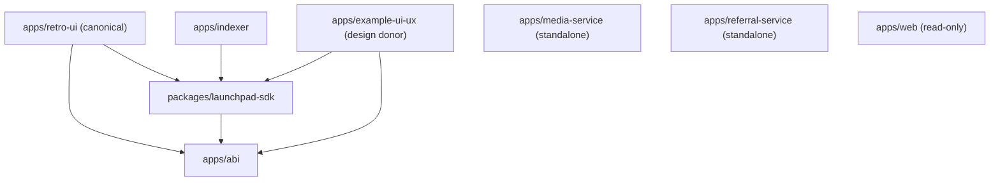

# Dependency and Runtime Boundary Map

**Verified manifests:** `main@ccad6e32109d03337b560c3c876848665d9d157a`, 2026-11-09.
**Confidence:** internal workspace dependencies are extracted from nine root/app/package `package.json` manifests. Network/runtime edges below are **documented configurations**, not observed production traffic. Dynamic imports and all source-level references remain untraced.

## Declared workspace dependency graph

These edges indicate `workspace:*` dependencies declared in manifests, **not** all imports or service calls.

| Workspace | Internal workspace dependencies | Position |
| --- | --- | --- |
| `@retropick/retro-ui` | `@retropick/abi`, `@retropick/launchpad-sdk` | Canonical frontend |
| `@retropick/example-ui-ux` | `@retropick/abi`, `@retropick/launchpad-sdk` | Design donor; preserve |
| `@retropick/indexer` | `@retropick/launchpad-sdk` | Canonical read-only event indexer |
| `@retropick/launchpad-sdk` | `@retropick/abi` | Typed contract-read/prepare/wallet SDK |
| `@retropick/abi` | None | Derived ABI catalog |
| `@retropick/media-service` | None | Standalone Node service |
| `@retropick/referral-service` | None | Standalone Node service |
| `@retropick/web` | None | Read-only Next.js reference |

The root `pnpm-workspace.yaml` includes `apps/*` and `packages/*`, with no evidence of a root Turborepo requirement. The frontend scripts use Vite and React 19; the historical `apps/web` uses Next.js and must not be silently substituted for the product frontend.

## Documented runtime communication

- `apps/retro-ui` reads an indexer HTTP API; `apps/indexer` persists a read model of Monad events. Economic writes are wallet-signed and broadcast to chain; the indexer is not an economic authority.
- `apps/referral-service` attributes confirmed activity sourced from the indexer, while `apps/media-service` provides token-image uploads.
- Root [`vercel.json`](../../vercel.json) builds `@retropick/retro-ui` with output `apps/retro-ui/dist` and routes `/v1/*`, `/health`, `/api/referrals/*`, `/api/media/*` and `/api/radar/*` to the configured staging API. These rewrite destinations are deployment configuration, **not proof** of a healthy live service.
- `apps/abi` and `packages/launchpad-sdk` are consumer-facing representations, not authoritative financial state. Onchain contracts and verified deployed bytecode remain separate release boundaries.

## Contract dependency and provenance boundaries

- Active V2: [`contracts/src/v2/`](../../contracts/src/v2/) under [contract security guardrails](../../contracts/AGENTS.md).
- Frozen deployed snapshot: [`contracts/legacy-v2/`](../../contracts/legacy-v2/) and [`deployments/monad-testnet/`](../../deployments/monad-testnet/).
- Solidity dependencies: two Git submodules, `contracts/lib/forge-std` and `contracts/lib/v4-deployment-periphery`, plus checked-in vendor/reference paths.
- V2, V3 and PRISM experiments have distinct change/release gates. A shared directory or dependency does not imply a safe cross-version refactor.

## Not-yet-proven edges

Before simplifying module boundaries, run source-level import analysis for TypeScript, dynamic ESM loads and Solidity, then cross-reference CLI commands, scripts, GitHub Actions, Vercel output paths, ABI generation, contract deployment/source-verification manifests, E2E fixtures and documented reproduction instructions.

This document maps *declared* dependencies only. **No import, runtime or financial semantic equivalence has been proven.**
