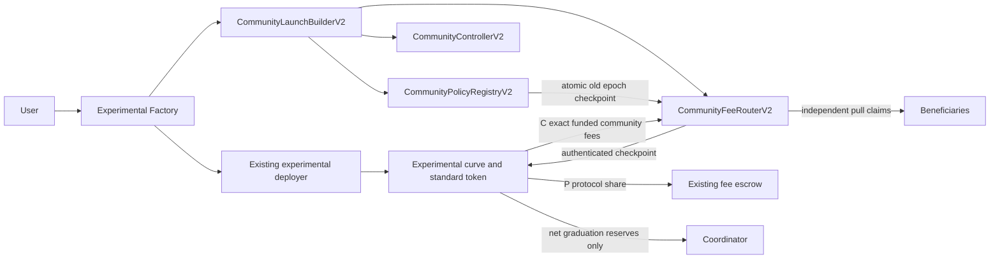
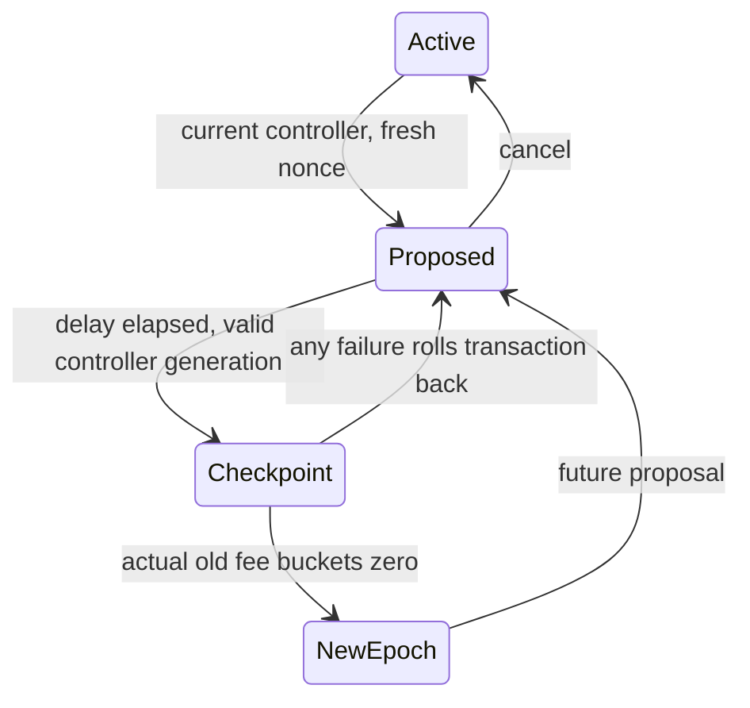
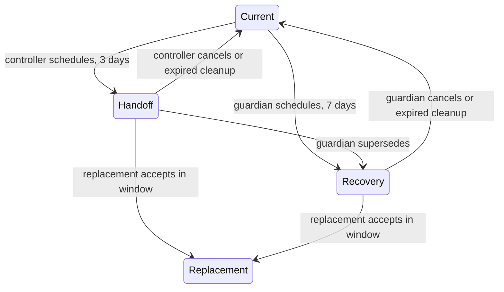

# Experimental curve community economy

Status: NEW_EXPERIMENT, local qualification only. No deployment or production promotion. Source baseline: canonical 28a4744dcc8005da285f9e924ba7841073daee0b; research parent 9a80398089b70498d8f8b5c41164a6d4c17b3cf5.

## Components and authority

| Component | Status | Custody and authority |
|---|---|---|
| Standard token, formula, quote admission, fee escrow, coordinator | EXISTING | Original economic terms and custody preserved |
| Factory | MODIFIED_EXPERIMENT | Owner sets builder once for future opt-in launches; launch pins existing economics and builder/config/codehash commitment; seals community launch flag |
| Curve | MODIFIED_EXPERIMENT | Immutable fee terms; accumulates F/T; one factory-only router binding before trading; no CE legacy recipient/buyback override |
| Builder | NEW_EXPERIMENT | Factory-only atomic deployment; creates real controller, router and registry; no asset custody |
| Controller | NEW_EXPERIMENT | Three-day voluntary handoff, seven-day guardian recovery, seven-day acceptance window; generation prevents stale policy execution; permissionless expiry cleanup |
| Registry | EXISTING_EXPERIMENT | Immutable constitution; at most ten recipients; one delayed future policy; no custody or upgrade |
| Router/checkpoint | NEW_EXPERIMENT | Per-launch and per-asset final community custody; immutable authenticated curve; exact funding; no owner/rescue; historical credits persist |
| Contributor splitter | IMPLEMENTED_IN_ROUTER | Bounded allocation at settlement; no per-trade recipient loop; independent partial claims |
| Treasury vault/rewards/strategy execution | DEFERRED | Current treasury is a disclosed fixed recipient; rewards and buybacks are ordinary earmarked module credits only, no qualified executing modules |
| v4 executor | MODIFIED_EXPERIMENT | CE pool snapshots zero hook fee/tax and disables buyback; LP fees remain pool LP fees; legacy registration unchanged |
| Kuru continuing creator revenue | BLOCKED_EXTERNAL_CAPABILITY | No proven entitlement or claim adapter |

Creator attribution, controller, economic beneficiary, protocol recipient and treasury are distinct. Controller changes only future administration. The original creator remains launch attribution; CE mode rejects legacy fee-recipient and buyback administration. Guardian controls recovery, not accrued balances. Category creator caps constrain declarations, not undisclosed beneficial ownership. No proxy or mutable router/source binding exists.

## Deployment and trust boundaries

Deploy original experimental factory environment, then builder bound to factory, then wire builder once. Factory creates token/curve through existing deployer and records identity. Within the same transaction it marks CE mode, calls builder, creates controller/router/registry, binds registry, then binds curve. Any failure rolls back launch. A launch-fee callback that trades before binding causes the binding precondition to fail and rolls back everything. Caller commitment pins builder identity/code and serialized configuration; original economics commitment independently pins trader-facing settings.

Router accepts native MON or the existing admitted Circle USDC address on chain 10143. Exact-transfer and non-rebasing behavior remains a deployment/admission assumption: sender and receiver deltas reject incompatible transfers; a later negative balance change fails closed and cannot restore destroyed backing. Separate router instances isolate launches. There is no arbitrary source registration or owner rescue. Unattributed surplus stays stranded rather than being reported as revenue.

## Policy and controller state machines

## ABI, migration and promotion

Additive factory community launch/builder/source APIs, curve binding/checkpoint APIs, module ABIs and events are experimental. Original launch path retains legacy behavior. Existing deployed contracts cannot acquire these bindings; new launches and, for v4, new pool registration are required. Indexer/SDK consumers need an explicit CE launch classification, builder event discovery, registry history, router credit events and controller generations. No consumer or production ABI artifacts were edited.

Graduation sweeps liabilities before securing net reserves; claims survive graduation. Real coordinator plus stateful venue seams are local integration evidence, not fork evidence. Full canonical LP qualification, live venue identity, gas review, treasury/rewards/strategies, independent audit and accepted economic ADR remain production blockers. Factory has only 90 runtime bytes of EIP-170 headroom; further factory features require architectural work.

The new CE entrypoint explicitly selects UNISWAP_V4; it does not add a Kuru CE launch mode. Existing legacy venue selection is unchanged. Protocol escrow authorization/backing remains an external liveness dependency for pending source settlement. Guardian recovery does not freeze existing controller authority during its delay; bounded future policies remain possible until handoff, while old funded credits stay unchanged. Treasury-key compromise is not repaired by a protocol rescue path.
