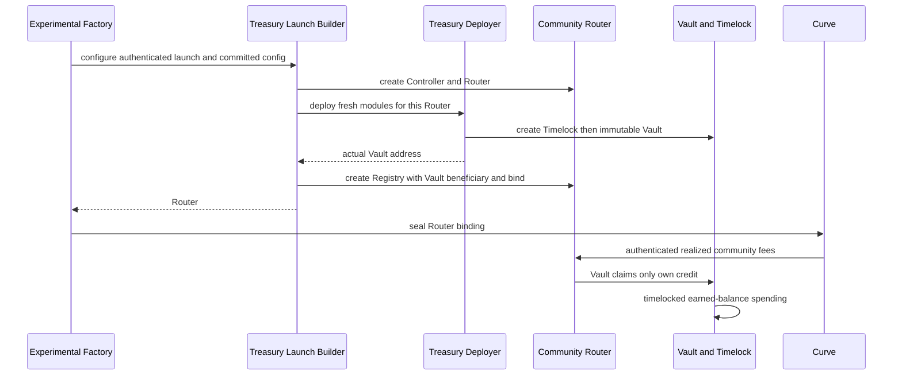

# Iteration 004: atomic treasury and restricted governance

Base: `7bad742b67e2fa58ebf680eadbfa6194d5bbf0c3`. Experimental implementation; canonical adoption remains proposed in ADR-CE02. Historical iteration003 evidence is unchanged.

## Question and decision

CE003-001 permits two launches to name one counterfactual beneficiary. Choose Option A: create the actual beneficiary inside the authenticated launch transaction. Option B adds reservation lifecycle and late-deployment liveness; Option C cannot prevent pre-selection stranded credit. Neither is implemented. Ordinary CREATE, rather than the unused token salt, supplies separate identities. No signature or creator address is treated as launch uniqueness.

## Deployment and trust boundary

Factory records token/curve, invokes its once-wired builder and seals curve after configure returns. The new TreasuryLaunchBuilder verifies the unchanged config commitment, real token/deployer/factory/curve identity and immutable nonproxy TreasuryDeployer codehash. It creates Controller and Router. TreasuryDeployer authenticates factory.communityBuilder, router.registrar, factory, fresh/unfunded state and token/router uniqueness. It creates a new Timelock and Vault, records identity, and returns the Vault. Builder substitutes the Vault into the treasury allocation and module, creates Registry and binds Router. Factory seals curve. Any error reverts the whole transaction, including deployment nonces and mappings. No public late finalizer or mutable initializer exists.

Version1 wraps the old Config with proposer. Require one positive treasury allocation with zero input beneficiary, zero treasury module placeholder, no reward/buyback modules and only creator/contributor/treasury kinds. Legacy Builder is unchanged. Factory runtime receives no added code. A different builder requires a separately deployed environment; this does not retrofit existing once-wired factories.

Vault constructor checks identities already available. Claim/spend additionally require ready Router, Registry token/source/module identity and sealed curve binding. Quote identity is immutable and inherited from the admitted real curve/router. The experiment is chain10143. Nonproxy deployer provenance is a qualification requirement: codehash alone cannot pin a proxy implementation.

## Accounting and authority

Real trade -> unchanged curve fee buckets -> protocol escrow and authenticated Router -> immutable Vault beneficiary credit -> permissionless claim of Vault's own credit -> Vault -> timelocked spend. Router remains the sole fee-entitlement ledger. Treasury's cumulative claimed/spent counters describe receipt and disposal, not an additional Router liability.

For the immutable fee asset, `held = claimed - spent`; `actualBalance >= held` is required before and after each mutation. Claim requires positive owned credit, exact Router credit reduction and exact receipt. Direct donations increase surplus only. Negative issuer balance changes produce a visible deficit and fail closed. No rescue, arbitrary call, approval, borrowing or surplus spending exists. Claims cannot conceal a pre-existing deficit by importing new earned funds. Spending requires Timelock, positive earned amount, correct asset, nonzero nonself recipient and unused nonzero spend ID. ERC20 sends verify sender and recipient deltas; native sends require success and exact Vault net debit. External-call failures revert all counters/credits/operation changes.

## Governance

Use the owner-approved isolated, hash-pinned OZ5.4.0 closure, retaining upstream scheduler/AccessControl mechanisms. The subclass fixes delay at72hours, permanently opens execution, leaves admin solely self-governed, permits only nonzero proposer/canceller membership changes through delayed self-calls, and rejects renunciation. Expiry is strictly after readiness+7days; equality is executable. Single and batch execution both enforce expiry before upstream execution. Arbitrary Timelock targets confer no arbitrary Vault capability: Vault exposes only restricted spend. Lost proposers or canceled/expired operations can impair liveness; controller recovery cannot recover treasury authority. EOA test proposers do not establish a live multisig threshold or key safety.

## Test boundaries

The binding-only probe forwards Router credit without custody and proves no delay. Real Treasury integration must independently establish atomic uniqueness/rollback, actual MON/USDC trading income, own-credit claims, policy/controller preservation, timelocked spending, callback/failure isolation and deficit rejection. Existing financial invariants are not treasury stateful invariants. See qualification evidence for measured coverage and remaining gaps. No venue entitlement, deployment or production safety claim follows from local tests.

## SDK/indexer and deployment handoff

No SDK/indexer code changes are included. A later client must encode `ConfigV1` for this specific Builder, commit its address/codehash/exact bytes, use zero treasury placeholders and read emitted/immutable actual Vault/Timelock identities. Never predict the treasury from token salt. Indexer should link TreasuryBound/TreasuryCreated/TreasuryInitialized, Router credit/claim and RevenueClaimed/RevenueSpent events; distinguish surplus from earned funds and upstream Ready from expiry-aware execution eligibility. Timelock operation hashes/salts/predecessors and role events are part of the disclosure. Factory records and Controller identity must not be replaced by the beneficiary address.

A separately reviewed future deployment would order Factory environment, TreasuryDeployer bound to Factory, TreasuryLaunchBuilder bound to both, then once-only authorized Factory wiring. Each launch atomically creates its own modules. Verify all implementation codehashes, dependencies, chain/quote policy and the actual multisig before any activation. This is a handoff description, not a deployment script or authorization. Existing deployments and historical ABI artifacts remain untouched.
